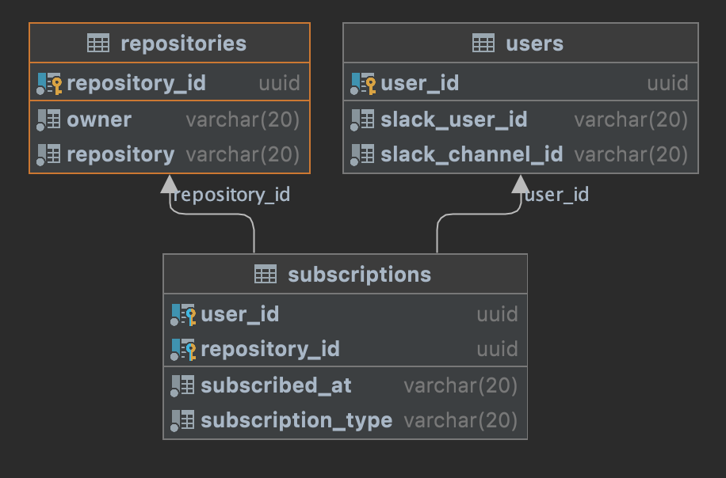

# Github Alerts Project 2021, 47 Degrees

---
Samir Kahvedzic

GitHub Notification Service for Slack
This service aims to send messages to a users Slack account, composed of Github repository events. 
A user may subscribe to the Github repositories for which they would like to receive events from.
Slack commands are used to subscribe to events, or alter parameters of the service for the user.


This application requires a postgress database. Use the following command to create a database with Docker.

docker run --name postgres -e POSTGRES_PASSWORD=mysecretpassword -e POSTGRES_DB=fortyseven -d -p 5432:5432 postgres
When executed, flyway should automatically create the DB Schema if the tables do not exist already. Table design can be found in V1__create_default_schema.sql under resources/db/migration

Application is configured to run on port 8080 @http://localhost:8080/, this can be changed in application.conf



Api Routes 
- GET /subscription/<user>
- DELETE /subscription/<user>
- PUT /subscription/<user>
- POST /subscription/slack/command

``` Example request
Method: GET
Response Body: {
  "subscriptions":[
    {
      "organization":"47deg",
      "repository":"thool",
      "subscribedAt":"2021-04-15T12:30:15"
    },
    {
      "organization":"higherkindness",
      "repository":"skeuomorph",
      "subscribedAt":"2021-04-26T15:45:25"
    },
    {
      "organization":"47degrees",
      "repository":"github4s",
      "subscribedAt":"2021-05-01T09:15:05"
    }
  ]
}
```

``` Example request
Method: PUT
Body: {
  "subscription" : {
    "organization" : "47deg",
    "repository" : "thool"
  }
}
```

``` Example request
Method: DELETE
Body: {
  "subscription" : {
    "organization" : "47deg",
    "repository" : "thool"
  }
}
```

``` Example request
Method: post
Body: {
  "response_type":"in_channel",
  "text":"It's 80 degrees right now.",
  "blocks":[
    {
      "type":"section",
      "text":{
        "type":"mrkdwn",
        "text":"*It's 80 degrees right now.*"
      }
    },
    {
      "type":"section",
      "text":{
        "type":"mrkdwn",
        "text":"Partly cloudy today and tomorrow"
      }
    }
  ]
}
```

Architecture

- Subscriber Service

- Event Service

- Notification Service

- Slack bot: slack integration able to interact with the Notification system

---

Stack: Typelevel

Libraries: Circe, Http4s, Cats-Effect

---

Project Spec: [Google Drive Project Spec](https://docs.google.com/document/d/1XnYEOn5uki0VMVOfcrYNhl-3uaruZBJrHM5zsnQuID0/edit#heading=h.piwgc9cf2cox)